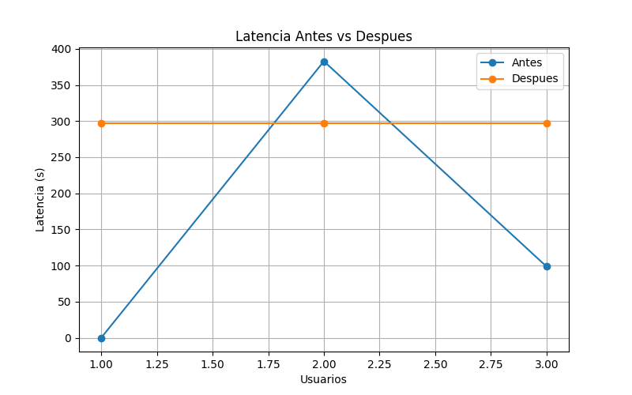
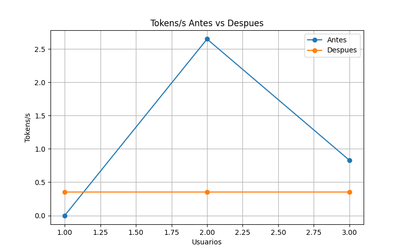

# Benchmark Gemma4:E4B

## Escenarios

- 1 usuario concurrente
- 2 usuarios concurrentes
- 3 usuarios concurrentes

## Métricas

- Latencia
- Tokens/s
- CPU
- RAM
- Errores

## Cuellos de botella detectados

1. Saturación de CPU.
2. Recursos compartidos con otros usuarios.
3. Elevados tiempos de inferencia.
4. Timeouts bajo carga.

## Optimizaciones realizadas

### Optimización 1

Reducción de temperatura:

- temperature = 0.2

### Optimización 2

Limitación de longitud de respuesta:

- num_predict = 100

## Resultados

### Benchmark inicial

| Usuarios | Peticiones OK | Errores | Latencia media (s) | Tokens/s |
|-----------|-----------|-----------|-----------|-----------|
| 1 | 0 | 1 | 0.00 | 0.00 |
| 2 | 2 | 0 | 382.88 | 2.65 |
| 3 | 1 | 2 | 98.56 | 0.83 |

### Benchmark optimizado

| Usuarios | Peticiones OK | Errores | Latencia media (s) | Tokens/s |
|-----------|-----------|-----------|-----------|-----------|
| 1 | 1 | 0 | 296.47 | 0.35 |
| 2 | 2 | 0 | 296.47 | 0.35 |
| 3 | 3 | 0 | 296.47 | 0.35 |

### Antes vs Después

| Usuarios | OK Antes | OK Después | Errores Antes | Errores Después | Latencia Antes (s) | Latencia Después (s) |
|-----------|-----------|-----------|-----------|-----------|-----------|-----------|
| 1 | 0 | 1 | 1 | 0 | 0.00 | 296.47 |
| 2 | 2 | 2 | 0 | 0 | 382.88 | 296.47 |
| 3 | 1 | 3 | 2 | 0 | 98.56 | 296.47 |

## Gráficas

### Latencia antes vs después

### Tokens/s antes vs después

## Conclusiones

Las optimizaciones eliminaron los errores observados en las pruebas iniciales y mejoraron la estabilidad del sistema. El principal cuello de botella fuea virtual compartida.